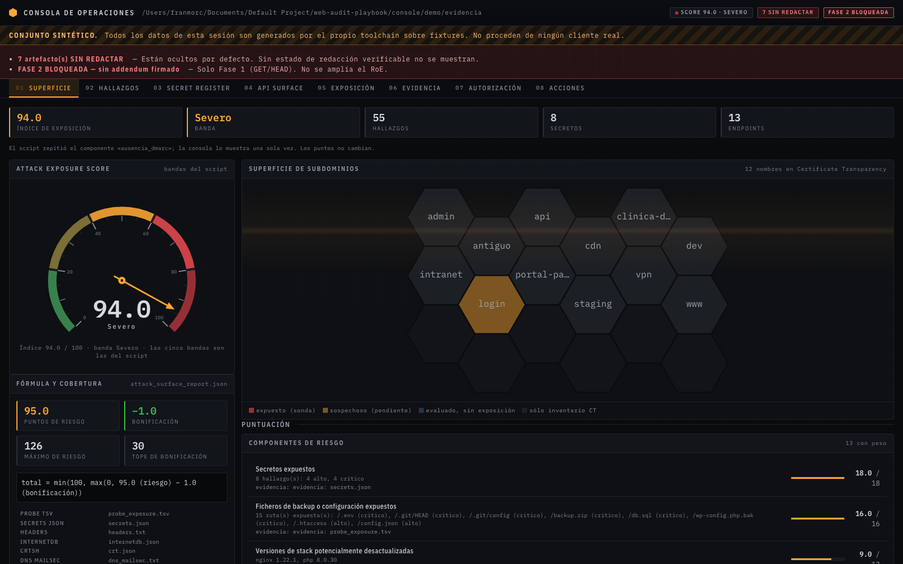

# Web Audit Playbook — Auditoría de seguridad web, método reproducible

Este playbook es un **sistema cerrado y reutilizable** para realizar revisiones
de seguridad (y cumplimiento) sobre sitios web de clientes pequeños y medianos —
clínicas, consultorios y profesionales con datos sensibles — todo desde una
**postura pasiva y autorizada**, y convertido en **tres entregables accionables**.

Nació de una auditoría real (Clínica Dental Easy, `dentaleasy.mx`, octubre
2026) y está organizado para que **se repita en el siguiente cliente sin
re-aprender el proceso**. Cada documento es un módulo: metodología, tooling,
plantillas, un caso de referencia, formación y formatos de trabajo.

---

## Cómo usar esto en un cliente nuevo

El playbook está pensado para un ciclo de **8 pasos**. Los pasos 1–2 son
preparación (una vez, reutilizables), los pasos 3–7 son la ejecución, el paso 8
cierra con la entrega.

### El flujo de 8 pasos

| # | Paso | Qué haces | Dónde está el material |
|:-:|---|---|---|
| **1** | **Alcance y RoE** | Define hosts en/fuera de alcance, modalidad (pasiva/activa), y las prohibiciones. **Hazlo firmar antes de tocar nada.** ⚠️ **La Fase 2 (explotación) no cabe aquí:** exige un **addendum firmado aparte, por las tres partes** (cliente, responsable técnico y auditor). | [`00-metodologia/reglas-de-autorizacion-y-roe.md`](00-metodologia/reglas-de-autorizacion-y-roe.md) · ejemplo relleno: [`05-plantillas-de-trabajo/alcance-y-roe.EJEMPLO.md`](05-plantillas-de-trabajo/alcance-y-roe.EJEMPLO.md) · addendum Fase 2: [`05-plantillas-de-trabajo/addendum-fase-2-explotacion-limitada.EJEMPLO.md`](05-plantillas-de-trabajo/addendum-fase-2-explotacion-limitada.EJEMPLO.md) |
| **2** | **Montar el caso** | Crea `03-casos/<cliente>/{informe-tecnico,evidencia}/` y copia el RoE firmado a la evidencia. | Este README, sección «Mapa del playbook» |
| **3** | **Recon pasivo + on-page** | Descarga el HTML crudo y guárdalo **todo** (es la evidencia de las fases 5–6). Corre `analyze.py` para el on-page y `water.py` para el waterfall de peso. | [`00-metodologia/ciclo-de-auditoria.md`](00-metodologia/ciclo-de-auditoria.md) Fases 2, 5 · scripts en el caso de referencia |
| **4** | **Infra, DNS y TLS** | `dig` (email auth contra varios resolvers), certificado y SANs (blast radius pasivo), test de TLS **corRECTAMENTE** (fijar `--tls-max`, forzar provider legacy, leer la versión negociada). | Ciclo Fases 3–4 (**ojo a la lección (b) del falso positivo de `--tlsv1.0`**) |
| **5** | **Plataforma web y exposición** | Stack/versiones, caché (soft-404, contenido cross-scheme), on-page. **Contrasta toda versión contra la fuente primaria** (lección (a)). | Ciclo Fase 5 · [`01-tooling/scripts/`](01-tooling/scripts/README.md) (`probe_exposure.py`, `header_tls_report.py`) |
| **6** | **Divulgación + email + phishing** | REST API (cadena de enumeración), secretos en JS, superficie de login, **DMARC/SPF/DKIM/CAA**, material de pretexting. **Reporta capacidades, nunca las ejecutes.** | Ciclo Fases 6–7 · RoE §1.3 (des-anonimización) · módulo [`exposicion-de-secretos.md`](00-metodologia/exposicion-de-secretos.md) |
| **7** | **Cumplimiento + riesgo + roadmap** | Mapeo a ley mexicana (LFPDPPP/LGS/LFPC) desde fuente primaria, registro de riesgo puntuado, priorización **ICE (rr_por_hora)**, hoja de ruta en 3 olas, borradores de ticket. | Ciclo Fases 8–10 · [`00-metodologia/como-presentar-resultados.md`](00-metodologia/como-presentar-resultados.md) · módulo [`exposicion-a-ataques.md`](00-metodologia/exposicion-a-ataques.md) |
| **8** | **Entregar en 3 capas** | (a) **Teaser** PDF de venta/primer contacto — cero técnico, valida con `verify.py`. (b) **Informe técnico** para su equipo/hosting/agencia — ⚠️ *confidencial, no al dueño*. (c) **Brief de lenguaje llano** para el dueño. §«Lo que ya está bien» obligatorio. | `02-plantillas/` (tres plantillas) · doctrina: `como-presentar-resultados.md` |

> **El paso 1 es el que no se salta.** Sin RoE firmado y con las prohibiciones
> claras, las fases 4–6 dejan de ser seguras.

> **⚠️ Ojo con las dos numeraciones de «fase».** No son la misma cosa y el
> nombre se repite: en [`ciclo-de-auditoria.md`](00-metodologia/ciclo-de-auditoria.md)
> las **11 fases** son los *pasos de la auditoría* (Fase 1 = alcance … Fase 11 =
> reporte); en el modelo comercial las **Fases 0 / 1 / 2** son *paquetes que se
> contratan*. El addendum de Fase 2 se llama así por el **paquete**, no por una
> fase del ciclo.

> **La progresión comercial es Fase 0 → Fase 1 → Fase 2.**
> El flujo de 8 pasos de arriba es **cómo se ejecuta un encargo**; la escalera
> de 3 fases es **cómo escala el negocio**. Cada fase responde a una pregunta
> distinta y produce la siguiente: *qué está expuesto* → *qué está mal y con
> qué base legal* → *cuánto cuesta de verdad*. El cliente que no firma el
> addendum de explotación no se pierde: se queda en Fase 0/1 y degrada con
> elegancia. Detalle: [`00-metodologia/modelo-de-servicio-y-escalabilidad.md`](00-metodologia/modelo-de-servicio-y-escalabilidad.md)
> · precios y propuesta lista para enviar: [`02-plantillas/propuesta-comercial/paquetes-por-fase.md`](02-plantillas/propuesta-comercial/paquetes-por-fase.md)

---

## Mapa del playbook

| Carpeta / archivo | Qué es |
|---|---|
| **`00-metodologia/`** | El método. Referencia operativa. |
| └─ [`ciclo-de-auditoria.md`](00-metodologia/ciclo-de-auditoria.md) | Las **11 fases** del ciclo de auditoría, con objetivo, herramientas, evidencia y lección aprendida de cada una. Incluye las dos lecciones duras: **contrastar con fuente primaria** (no confiar en el string del escáner) y la **semántica de `curl --tlsv1.x`** que produjo un falso positivo. |
| └─ [`reglas-de-autorizacion-y-roe.md`](00-metodologia/reglas-de-autorizacion-y-roe.md) | La doctrina de seguridad: las **5 prohibiciones duras** (nunca POST, no tocar datos de terceros, no des-anonimizar, no sondear terceros, no escanear IPs compartidas), el ritmo, y la **regla de decisión para hallazgos de terceros**. Plantilla de RoE. |
| └─ [`como-presentar-resultados.md`](00-metodologia/como-presentar-resultados.md) | La doctrina de reporte: matriz de severidad, **por qué ICE y no RICE**, las **tres capas**, y la obligatoriedad de «Lo que ya está bien». |
| └─ [`fase-2-explotacion-autorizada.md`](00-metodologia/fase-2-explotacion-autorizada.md) | **Metodología de la Fase 2:** explotación autorizada y limitada, prueba sin daño, **matriz de destructividad**, procedimiento operativo (ventana de 3 h, «go» por prueba, criterio de abort) y checklist de salida. Ejecuta el addendum; no es un pentest. |
| └─ [`exposicion-de-secretos.md`](00-metodologia/exposicion-de-secretos.md) | **Módulo de exposición de secretos:** verificación de credenciales sin usarlas, *Secret Register*, superficie de API, credenciales de BD, datos personales no enmascarados y reglas de redacción de la evidencia. |
| └─ [`exposicion-a-ataques.md`](00-metodologia/exposicion-a-ataques.md) | **Módulo de exposición a ataques:** qué se ve desde fuera y qué no, IoC, fuentes pasivas y logs internos, el **Attack Exposure Score** y cómo presentarlo al dueño sin inventar el número. |
| └─ [`modelo-de-servicio-y-escalabilidad.md`](00-metodologia/modelo-de-servicio-y-escalabilidad.md) | **El negocio detrás del método:** los 3 paquetes (Fase 0/1/2), precios, marco legal que tiene que existir **antes** de vender, unidad económica, escalabilidad, riesgos y plan de 30 días. |
| **`01-tooling/`** | |
| └─ [`manifiesto-de-herramientas.md`](01-tooling/manifiesto-de-herramientas.md) | **La tabla.** Toda herramienta usada (o candidata) con para-qué, URL, licencia, pasiva/activa, fase, y el aviso de licencias **copyleft/AGPL** y qué significa si reempaqueta. |
| └─ [`scripts/`](01-tooling/scripts/README.md) | **Toolchain propia:** 7 scripts de Python 3.13 **stdlib, cero dependencias**. Su [`README.md`](01-tooling/scripts/README.md) tiene el flujo completo y el aviso legal de uso. |
| └─ └─ [`scope_guard.py`](01-tooling/scripts/scope_guard.py) | **La única puerta a la red.** Valida la autorización firmada: ventana de vigencia, host, método (recorta a GET/HEAD), intervalo ≥ 1 s y UA honesto. **Aborta** si algo no cuadra. |
| └─ └─ [`probe_exposure.py`](01-tooling/scripts/probe_exposure.py) | Sonda de exposición: 53 rutas conocidas (`.env`, `.git/HEAD`, backups, `phpinfo.php`…) con **detección de soft-404** por `sha256`. No guarda el cuerpo de las rutas sensibles. |
| └─ └─ [`secrets_scan.py`](01-tooling/scripts/secrets_scan.py) | Escaneo **local** de secretos (AWS, Stripe, JWTs, claves privadas…). Escribe sólo `4+2` caracteres y el `sha256[:12]`: **jamás el valor completo**. |
| └─ └─ [`js_intel.py`](01-tooling/scripts/js_intel.py) | Inteligencia del JavaScript público: endpoints, integraciones de terceros, destinos de formularios y secretos embebidos. |
| └─ └─ [`header_tls_report.py`](01-tooling/scripts/header_tls_report.py) | Postura de cabeceras de seguridad y TLS calculada sobre la evidencia ya descargada. No hace llamadas propias. |
| └─ └─ [`pii_redact.py`](01-tooling/scripts/pii_redact.py) | **Redacción de PII y secretos** antes de compartir evidencia. Genera la copia sanitizada y el informe de conteos. |
| └─ └─ [`attack_surface_report.py`](01-tooling/scripts/attack_surface_report.py) | Consolida sonda + secretos + cabeceras en el **Attack Exposure Score** y su informe Markdown/JSON. |
| └─ └─ [`authorization.example.json`](01-tooling/scripts/authorization.example.json) | Formato de la autorización firmada que consume `scope_guard.py` (hosts, ventana, métodos, firma). Plantilla a rellenar. |
| └─ └─ [`tests/selftest.py`](01-tooling/scripts/tests/selftest.py) | Auto-prueba: 19 checks **sin ninguna llamada de red**. `python3 tests/selftest.py` desde `01-tooling/scripts`. |
| **`console/`** | Consola interna de operaciones de seguridad: 8 vistas (superficie, hallazgos, secret register, API surface, exposición a ataques, evidencia, autorización, registro de acciones). Backend Python stdlib, cero dependencias, cero peticiones externas. |
| └─ [`README.md`](console/README.md) | Cómo arrancarla, qué evidencia espera y el aviso de que no sustituye la revisión humana. |
| └─ [`QA-VISUAL.md`](console/docs/QA-VISUAL.md) | Auditoría visual con navegador real: contraste WCAG por vista, desbordamientos, cargas de red y correcciones aplicadas. |
| **`deploy/`** | Stack de la VPS autoalojada: Ollama, consola, Open WebUI opcional, almacén de hallazgos y red privada. |
| └─ [`docker-compose.yml`](deploy/docker-compose.yml) | Definición del stack. Ningún puerto de administración se publica en `0.0.0.0`. |
| └─ [`README.md`](deploy/README.md) | Despliegue paso a paso, backup, rotación de secretos y firewall. |
| └─ [`hardening.md`](deploy/hardening.md) | Checklist de endurecimiento con el comando de verificación de cada control. |
| **`02-plantillas/`** | Las tres capas de entregable, como plantillas. |
| └─ [`teaser-report/`](02-plantillas/teaser-report/) | Plantilla del teaser PDF (HTML→PDF, gráficos, `verify.py`, reglas de contenido «cero técnico»). Ya construida. |
| └─ [`informe-completo/`](02-plantillas/informe-completo/README.md) | Estructura del informe técnico de **10 secciones (§0–§9)** — capa 2. Referencia viva: el caso real. |
| └─ └─ [`anexo-explotacion-limitada.md`](02-plantillas/informe-completo/anexo-explotacion-limitada.md) | Plantilla del **anexo de Fase 2** que se añade al informe técnico: hallazgos explotados, impacto real vs. máximo teórico, «Lo que NO se hizo» y datos reales expuestos (categoría, **nunca el valor**). |
| └─ [`propuesta-comercial/`](02-plantillas/propuesta-comercial/README.md) | Estructura de la propuesta comercial (lo que se manda **antes** de auditar). |
| └─ └─ [`paquetes-por-fase.md`](02-plantillas/propuesta-comercial/paquetes-por-fase.md) | **Los 3 paquetes comerciales listos para enviar** (Fase 0 / 1 / 2): precios, inclusiones, exclusiones y camino recomendado. **Fuente autoritativa de precios.** |
| **`03-casos/`** | Casos reales de referencia. ⚠️ **No se versiona**: está excluido en el [`.gitignore`](.gitignore) porque contiene evidencia de un cliente real y confidencial. Vive sólo en el disco del auditor. |
| └─ `clinica-dental-easy/` | El caso que originó el playbook (Clínica Dental Easy, `dentaleasy.mx`, octubre 2026). Informe técnico completo + evidencia (98 archivos). ⚠️ **Confidencial: no se publica.** |
| **`04-formacion/`** | Formación del auditor: laboratorio seguro, toolkit de terceros y marco legal/de negocio. |
| └─ [`01-lab-seguro.md`](04-formacion/01-lab-seguro.md) | Laboratorio propio para practicar recon y pruebas controladas sin tocar objetivos reales. |
| └─ [`02-herramientas-y-python.md`](04-formacion/02-herramientas-y-python.md) | Toolkit curado de herramientas de terceros, con la línea de autorización dibujada en cada una. |
| └─ [`03-modelo-de-negocio-y-legal-mx.md`](04-formacion/03-modelo-de-negocio-y-legal-mx.md) | Modelo de negocio, tabla de precios y marco legal mexicano del servicio. |
| └─ [`LEEME.md`](04-formacion/LEEME.md) | Alcance previsto de la **guía de metodología didáctic** (pendiente de escribir). |
| **`05-plantillas-de-trabajo/`** | Formatos de captura rellenables. |
| └─ [`registro-de-acciones.EXAMPLE.csv`](05-plantillas-de-trabajo/registro-de-acciones.EXAMPLE.csv) | CSV maestro (id, dominio, severidad, hallazgo, evidencia, comando, owner, effort, rr_por_hora, estado) con filas reales del caso dental. |
| └─ [`alcance-y-roe.EJEMPLO.md`](05-plantillas-de-trabajo/alcance-y-roe.EJEMPLO.md) | RoE relleno para un cliente hipotético siguiente. |
| └─ [`addendum-fase-2-explotacion-limitada.EJEMPLO.md`](05-plantillas-de-trabajo/addendum-fase-2-explotacion-limitada.EJEMPLO.md) | **Addendum de autorización de Fase 2, listo para firmar por tres partes:** las 6 técnicas una por una (con casilla de rechazo), 11 prohibiciones que no se levantan, ventana, «go», criterio de abort, minimización, retención y firmas. |
| └─ [`registro-de-acciones-fase-2.csv`](05-plantillas-de-trabajo/registro-de-acciones-fase-2.csv) | Formato de captura de acciones de Fase 2: hora, host, endpoint, técnica, cuenta usada, datos tocados, footprint, rollback y severidad — incluidas las **refutadas y las no ejecutadas**. |
| **`research/`** | Investigación que sostiene las decisiones de stack. No es metodología: es el **porqué** de cada decisión técnica, con la fecha en que se verificó cada dato. |
| └─ [`06-stack-y-ecosistema.md`](research/06-stack-y-ecosistema.md) | Stack para escalar: runtime LLM autoalojado (Ollama / llama.cpp), interfaz interna, tooling de la consola y **qué se descartó y por qué**. |



*La vista 01 SUPERFICIE de la consola en modo demostración (conjunto sintético):
el dial del score, la fórmula y el hex-grid de subdominios.*

---

## Atajos — qué hacer si...

| Si lo que quieres es… | Ve a |
|---|---|
| **Encontrar un `.env` expuesto** (u otra ruta sensible) | [`01-tooling/scripts/probe_exposure.py`](01-tooling/scripts/probe_exposure.py) — sonda de exposición con detección de soft-404 |
| **Ver si un token está vivo** (sin usarlo contra nada ajeno) | [`00-metodologia/exposicion-de-secretos.md`](00-metodologia/exposicion-de-secretos.md) — protocolo escalonado de verificación + *Secret Register* |
| **Saber cuántos ataques ha recibido la página** | [`00-metodologia/exposicion-a-ataques.md`](00-metodologia/exposicion-a-ataques.md) — qué se ve desde fuera y qué no, y el *Attack Exposure Score* |
| **Demostrar el impacto con autorización** | [`05-plantillas-de-trabajo/addendum-fase-2-explotacion-limitada.EJEMPLO.md`](05-plantillas-de-trabajo/addendum-fase-2-explotacion-limitada.EJEMPLO.md) (firmar) → [`00-metodologia/fase-2-explotacion-autorizada.md`](00-metodologia/fase-2-explotacion-autorizada.md) (ejecutar) |
| **Redactar PII antes de entregar evidencia** | [`01-tooling/scripts/pii_redact.py`](01-tooling/scripts/pii_redact.py) — **obligatorio** antes de compartir cualquier evidencia |
| **Preparar un cliente** (propuesta que se manda antes de auditar) | [`02-plantillas/propuesta-comercial/paquetes-por-fase.md`](02-plantillas/propuesta-comercial/paquetes-por-fase.md) — los 3 paquetes listos para enviar |
| **Obtener el score de exposición** | [`01-tooling/scripts/attack_surface_report.py`](01-tooling/scripts/attack_surface_report.py) — consolida sonda + secretos + cabeceras |
| **Calcular el margen** (y si el negocio es viable) | [`00-metodologia/modelo-de-servicio-y-escalabilidad.md`](00-metodologia/modelo-de-servicio-y-escalabilidad.md) — unidad económica y escalabilidad |

---

## Principios que gobiernan todo el playbook

1. **Cada afirmación se traza a un archivo de evidencia.** Si no hay archivo,
   no hay hallazgo.
2. **Pasiva por defecto.** El activo es una decisión del cliente, no tuya.
3. **El daño > el hallazgo.** Perder un hallazgo cuesta; causar daño cuesta más.
   Ante la duda, es `INFO`, no ejecutas.
4. **El escáner propone, la fuente primaria dispone.** Toda versión y todo CVE
   se contrastan contra la fuente oficial (lección (a)).
5. **Reporta la capacidad, no la explotación.** Des-anonimizar, romper hashes y
   ejecutar cadenas ofensivas está prohibido — se documentan como riesgo y
   punto.
6. **Describe terceros, no los ataques.** Un tercero descubierto en recon se
   reporta como relación/riesgo; no se toca.
7. **Verifica o refuta, explícitamente.** Un refute legal sólido genera más
   confianza que un hallazgo dudoso. Nunca cites una ley de memoria.
8. **«Lo que ya está bien» es obligatorio.** Sin positivos, los negativos no
   tienen referencia y el informe se lee como marketing.

---

## Convenciones del proyecto

- **Idioma:** español en toda la documentación y los entregables al cliente.
  Los nombres de archivo y comandos técnicos van en inglés o español según el
  caso.
- **Herramientas propias en [`01-tooling/scripts/`](01-tooling/scripts/README.md):**
  Python 3.13 **stdlib, cero dependencias** (nada de `pip install`). Cada script
  hace una cosa, es corto y se reproduce con un comando. La red se abre **sólo**
  por [`scope_guard.py`](01-tooling/scripts/scope_guard.py): si el RoE no cuadra,
  no se sale. Auto-prueba sin red: `python3 tests/selftest.py` desde
  `01-tooling/scripts`.
- **🔴 Redacción obligatoria antes de compartir cualquier evidencia:** todo
  fichero que salga del escritorio del auditor —al cliente, a hosting, a la
  agencia, a un ticket, a una captura— pasa por
  [`pii_redact.py`](01-tooling/scripts/pii_redact.py). Ni valores de secretos,
  ni datos de pacientes, ni expedientes: ni en la evidencia, ni en la
  transcripción, ni en la línea de comando que se copia al informe. **El crudo
  no se sobrescribe ni se envía:** se entrega la copia sanitizada.
- **Nombres de evidencia por contenido**, no por herramienta
  (`tls_versions.txt`, no `openssl.txt`).
- **Los falsos positivos se conservan** (ej. `evidencia/tls_floor.txt`). Una
  carpeta de evidencia donde todo salió bien a la primera es sospechosa.
- **Nada pesado en el repo:** el `.venv/` del teaser (~196 MB) está excluido en
  [.gitignore](.gitignore) y es regenerable (ver el README del teaser).
- **Al cerrar cada auditoría**, añade el caso a `03-casos/` y las herramientas
  nuevas a `01-tooling/`. El playbook crece con cada cliente.

---

## Inicio rápido (resumen en 5 líneas)

1. Copia [`alcance-y-roe.EJEMPLO.md`](05-plantillas-de-trabajo/alcance-y-roe.EJEMPLO.md), rellénalo y **fírmalo** — y si vas a Fase 2, firma además el [addendum](05-plantillas-de-trabajo/addendum-fase-2-explotacion-limitada.EJEMPLO.md), que es un documento aparte.
2. Crea `03-casos/<cliente>/{informe-tecnico,evidencia}/` y el `authorization.json` de `01-tooling/scripts/`.
3. Sigue [`ciclo-de-auditoria.md`](00-metodologia/ciclo-de-auditoria.md) fase por fase con las herramientas de `01-tooling/scripts/`, guardando la evidencia.
4. **Redacta antes de compartir:** pasa todo por [`pii_redact.py`](01-tooling/scripts/pii_redact.py) — ni valores de secretos ni datos de pacientes salen del escritorio.
5. Puntúa con [`como-presentar-resultados.md`](00-metodologia/como-presentar-resultados.md) (ICE, no RICE) y entrega las tres capas desde `02-plantillas/` — y **recuerda**: el informe técnico es confidencial; el dueño recibe el teaser y el brief.

---

## Contribuir

Este playbook es un sistema vivo: cada auditoría aporta un método nuevo y una
herramienta nueva. Contributions welcome — con tres reglas que no se negocian:
**nada de datos de clientes reales, nada de PII, nada de secretos reales.**

| Documento | De qué trata |
|---|---|
| [`CONTRIBUTING.md`](CONTRIBUTING.md) | El flujo (branch → PR), la convención de evidencia por contenido, la regla de redacción obligatoria con `pii_redact.py` y las prohibiciones de subir datos de clientes. |
| [`CODE_OF_CONDUCT.md`](CODE_OF_CONDUCT.md) | El comportamiento esperado en la comunidad. |
| [`SECURITY.md`](SECURITY.md) | Política de reporte responsable, tabla de severidades y la declaración de la empresa. |
| [`CHANGELOG.md`](CHANGELOG.md) | Qué se entregó en cada versión. |

**Cómo empezar:**

```bash
git clone https://github.com/franciscomorenosys/web-audit-playbook.git
cd web-audit-playbook
python3 01-tooling/scripts/tests/selftest.py        # 19 checks, sin red
python3 01-tooling/scripts/tests/check_links.py     # enlaces relativos
```

La CI de cada push y de cada PR ejecuta: compilación de todos los scripts
(`py_compile`), la auto-prueba del toolkit, el chequeo de enlaces relativos y
un escaneo de secretos con **gitleaks**. Los scripts son Python 3.13 **stdlib,
cero dependencias**: nada de `pip install`.

> **Este repositorio es la metodología, no un encargo.** No auditamos,
> pentesteamos ni exploramos sistemas de información sin autorización escrita
> del propietario; RoE y addendum firmados antes de cualquier prueba. Un issue
> no es una vía para pedir una prueba contra un sistema.

---

## Seguridad

Este repositorio maneja material que, si se filtra, **identifica a pacientes**.
Por eso la política de datos y la de reporte responsable son parte del
proyecto, no un añadido.

| Documento | De qué trata |
|---|---|
| [`SECURITY.md`](SECURITY.md) | Política de reporte responsable, tabla de severidades, canal de reporte y declaración de la empresa. |
| [`CODE_OF_CONDUCT.md`](CODE_OF_CONDUCT.md) | El comportamiento esperado en la comunidad. |
| [`.gitignore`](.gitignore) | La regla que mantiene `03-casos/`, la evidencia y las autorizaciones firmadas **fuera** del repositorio. |
| [`.gitleaks.toml`](.gitleaks.toml) | Allowlist de los secretos **sintéticos** del propio repo (los de los fixtures de prueba y el ejercicio de formación). Es lo que permite que la CI detecte secretos reales sin ruido. |

**Cuatro reglas que no se saltan en un PR:**

1. **Nada de datos de cliente real, nada de PII, nada de secretos reales.**
2. La evidencia pasa por [`pii_redact.py`](01-tooling/scripts/pii_redact.py)
   **antes** de entrar en el repositorio.
3. Los valores de ejemplo son **sintéticos** y están declarados uno a uno en
   [`.gitleaks.toml`](.gitleaks.toml). Un valor que no esté declarado ahí
   bloquea la CI.
4. La CI ejecuta `secrets_scan.py` **y** gitleaks: los dos tienen que salir
   limpios.

---

## Licencia

Este repositorio tiene **dos licencias**:

| Qué | Licencia | Dónde |
|---|---|---|
| **El código** — `01-tooling/scripts/`, `02-plantillas/teaser-report/*.py`, la CI | **MIT** | [`LICENSE`](LICENSE) |
| **La metodología, las plantillas y la formación** — `00-metodologia/`, `02-plantillas/`, `04-formacion/`, `05-plantillas-de-trabajo/` | **CC BY-NC-ND 4.0** (atribución, no comercial, sin derivados) | [`LICENSE-DOCS.md`](LICENSE-DOCS.md) · [texto canónico](https://creativecommons.org/licenses/by-nc-nd/4.0/deed.es) |

© 2026 Francisco Moreno.

**El porqué de la separación:** la metodología puede circular — otros
profesionales la usan, los clientes la leen, se forma auditor con ella — pero
**no se puede revender como servicio**. El código es una herramienta y queda
libre (MIT); el método es el negocio y va con una licencia que lo protege.

**Y una nota que va más allá de la licencia:** la evidencia de los casos reales
**no se publica**. `03-casos/` está en el [`.gitignore`](.gitignore) y
[`SECURITY.md`](SECURITY.md) explica por qué.