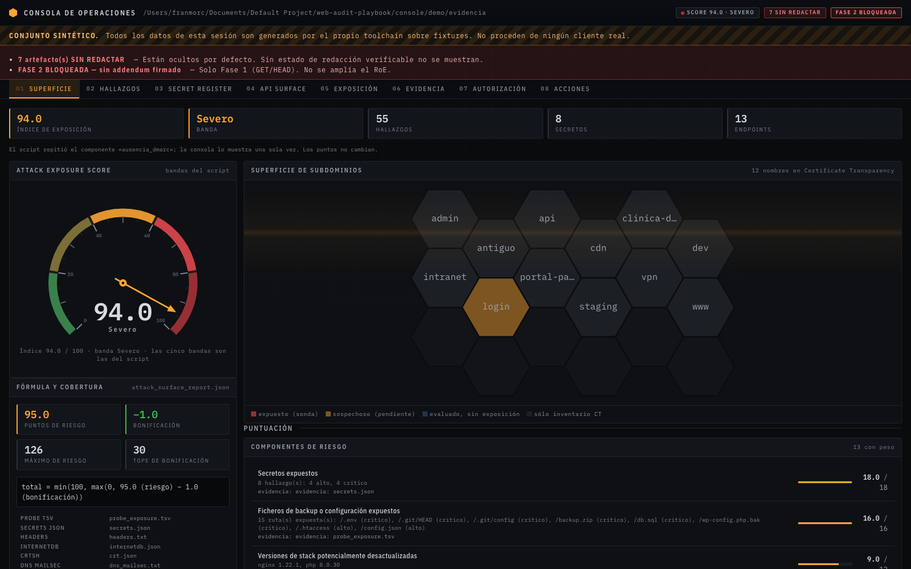
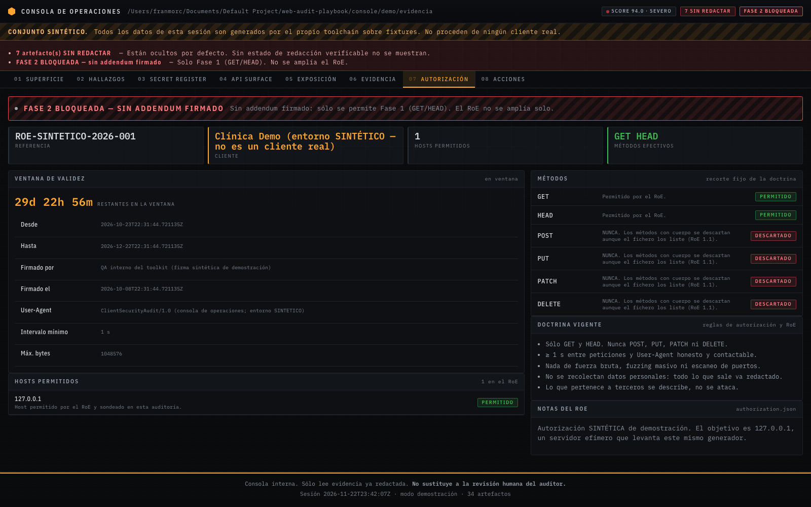
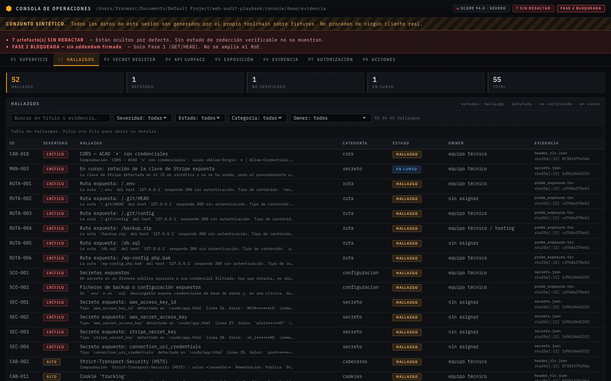

# Consola de Operaciones de Seguridad

Consola **interna** de trabajo para el auditor de seguridad web. No es una
landing page ni un producto que se venda: es el instrumento que se abre en la
VPS del auditor mientras se trabaja sobre un expediente, con la evidencia
recogida por el toolchain de `01-tooling/scripts/`.

> **Esta consola no sustituye a la revisión humana del auditor.** Muestra lo
> que la evidencia sostiene y, sobre todo, lo que **no** sostiene. Un número
> sin fuente no es un hallazgo; una exposición sin confirmar no es un
> compromiso. Todo lo que se ve aquí es un punto de partida para el
> razonamiento profesional, nunca su sustituto.

> **Sólo debe usarse con evidencia redactada.** La consola lee artefactos ya
> saneados por `pii_redact.py`. Los que no tienen estado de redacción
> verificable se marcan **SIN REDACTAR** y se **ocultan por defecto**: es una
> regla de seguridad, no una preferencia de maquetación.

---

## Arranque

```bash
# Modo demostración: conjunto sintético, sin tocar ningún cliente
python3 console/server.py --demo --port 8787

# Modo real: el directorio de evidencia que tengas en disco
python3 console/server.py --evidence ./mi-evidencia --port 8787 --no-open
```

No hay build step, ni `npm install`, ni `pip install`. Se abre con
`python3 console/server.py` y ya funciona. **Python 3.13 de biblioteca
estándar**: cero dependencias de runtime.

La consola se sirve en `http://127.0.0.1:8787/` (por defecto sólo en
localhost; `--host 0.0.0.0` la expone en la red de la VPS, que es lo que
hace falta si el auditor entra por SSH con túnel).

### Flags

| Flag | Por defecto | Qué hace |
|---|---|---|
| `--evidence DIR` | — | Directorio de evidencia a leer (modo real). |
| `--demo` | apagado | Carga el conjunto sintético de `console/demo/evidencia/`. |
| `--host H` | `127.0.0.1` | Interfaz de escucha. |
| `--port P` | `8787` | Puerto de escucha. Si está ocupado, prueba el siguiente. |
| `--no-open` | apagado | No abre el navegador al arrancar. |

Sin `--evidence` ni `--demo`, la consola arranca con el conjunto de
demostración y lo dice en la barra superior.

---

## Docker

La consola se empaqueta para la VPS del auditor en
[`Dockerfile`](Dockerfile) (base `python:3.13-slim`, usuario no-root,
cero dependencias).

### Construir

```bash
# Desde la RAÍZ del repositorio. OJO: el contexto es la raíz, no `console/`,
# porque la imagen necesita `console/` Y `01-tooling/scripts/` (el toolchain
# que la consola invoca para el score y para la demo).
docker build -t web-audit-playbook/console:local -f console/Dockerfile .
```

El `.dockerignore` de la raíz es una lista blanca: sólo viajan `console/` y
`01-tooling/scripts/`. `03-casos/` (la evidencia de clientes reales) **nunca
entra en el contexto de build**.

### Ejecutar

```bash
# La evidencia en SOLO LECTURA y el puerto publicado sólo en el loopback
# del host: el acceso es por túnel SSH o VPN.
docker run --rm \
  -p 127.0.0.1:8787:8787 \
  -v /opt/audit/evidencia:/data/evidencia:ro \
  web-audit-playbook/console:local
```

Y la consola queda en `http://127.0.0.1:8787` por el túnel:

```bash
ssh -N -L 8787:127.0.0.1:8787 usuario@<ip-de-la-vps>
```

> **La evidencia va en SOLO LECTURA.** El montaje termina en `:ro`: la
> consola no puede escribir ni borrar evidencia cruda, ni por error ni por un
> bug. No es una convención: es el montaje.
>
> **El puerto tiene que quedar detrás de una VPN o de un túnel SSH.** La
> consola **no implementa autenticación propia**: es un servidor HTTP de la
> stdlib de Python. Publícalo **sólo** en `127.0.0.1` y accede por
> `ssh -L` o por VPN. **Nunca en `0.0.0.0`.** (Ver
> [`../deploy/README.md`](../deploy/README.md) §3.3 y
> [`../deploy/hardening.md`](../deploy/hardening.md) §3.)

### Qué monta el stack

El `docker-compose.yml` de `deploy/` monta la evidencia en `/evidencia:ro` y
sobrescribe el `command:` de la imagen (que usa `/data/evidencia`). El
comportamiento es el mismo: **nunca en modo demo**, siempre leyendo un
directorio de evidencia.

### La demo dentro del contenedor

El conjunto de demostración **no va en la imagen**: se genera en tiempo de
ejecución con el propio toolchain.

```bash
docker compose -f ../deploy/docker-compose.yml run --rm --no-deps console \
  python3 console/demo/generar_demo.py
```

Lo que se escribe se queda dentro del contenedor (desechable). Para
conservarlo, monta un volumen sobre
`/app/console/demo/evidencia`. Ver
[`../deploy/README.md`](../deploy/README.md) §3.5.

---

## Las ocho vistas

Se navegan por **hash**, así que cada vista tiene URL propia y es
enlazable. La barra superior lleva el score, el estado de redacción y el
estado de fase.

| # | Hash | Vista | Qué resuelve |
|---|---|---|---|
| 01 | `#/superficie` | **SUPERFICIE** | El Attack Exposure Score como dial instrumental, el desglose de los 13 componentes de riesgo con su peso y su fuente (`evidencia: <fichero>`), y la bonificación por lo que ya está bien. Debajo, el hex-grid de subdominios coloreado por exposición. |
| 02 | `#/hallazgos` | **HALLAZGOS** | Tabla densa y filtrable (severidad, categoría, estado, owner, búsqueda libre). Al pulsar una fila se abre un drawer con descripción, evidencia referenciada por fichero con su hash corto, comando de reproducción, footprint y estado. |
| 03 | `#/secretos` | **SECRET REGISTER** | La tabla de 12 columnas del módulo de secretos: valores **enmascarados** (`4 + 6 + 2`), fingerprint `sha256[:12]`, tríada `sí / no / no probado` y flag de rotación urgente. **Nunca** el valor completo. |
| 04 | `#/api-surface` | **API SURFACE** | Endpoints descubiertos: método, ruta, auth, PII sí/no y severidad, con filtro «devuelve PII». |
| 05 | `#/exposicion` | **EXPOSICIÓN A ATAQUES** | Checklist de los 18 IoC con su estado, la tabla «afirmación vs. lo que la evidencia sostiene» y la sección **LO QUE NO PUEDO VER**: lo que ningún auditor externo puede saber. |
| 06 | `#/evidencia` | **EVIDENCIA** | Índice de ficheros: ruta, tamaño, sha256 corto, mtime y estado de redacción. Banner superior si hay algo sin verificar. |
| 07 | `#/autorizacion` | **AUTORIZACIÓN** | El RoE: cliente, referencia, **ventana con cuenta atrás en vivo**, hosts permitidos (los que quedan fuera se marcan en rojo), métodos permitidos y el estado prominente **«FASE 2 BLOQUEADA — sin addendum firmado»**. |
| 08 | `#/acciones` | **REGISTRO DE ACCIONES** | El `registro-de-acciones-fase-2.csv` como flujo tipo terminal. Las filas con `datos_tocados != ninguno` salen resaltadas. |

---

## Vista previa

Tres capturas del **modo demostración** (conjunto sintético, ningún dato de un
cliente real): la superficie con su score y su hex-grid, el RoE con su ventana
de validez y la tabla de hallazgos.







---

## Qué ficheros espera del directorio de evidencia

Todos son **opcionales**: si falta uno, su vista queda vacía con el motivo
explícito. Nunca hay un 0 disfrazado de dato.

| Fichero | Lo produce | Para qué lo usa la consola |
|---|---|---|
| `probe_exposure.tsv` | `probe_exposure.py` | Hallazgos de rutas expuestas y hosts sondeados. |
| `secrets.json` | `secrets_scan.py` | Secret Register (sólo máscaras y hashes). |
| `attack_surface_report.json` | `attack_surface_report.py --out` | El score ya calculado. Si no está, la consola lo calcula con el script del toolchain; si tampoco lo encuentra, dice *«sin score: ejecuta el script»*. |
| `headers.txt` | `curl -D` / `httpx -D` | Versiones de stack, CORS, cookies, HSTS. |
| `header_tls.json` | `header_tls_report.py --json` | Hallazgos de cabeceras. |
| `js_intel.json` | `js_intel.py --json-out` | Superficie de API y terceros. |
| `dns_mailsec.txt` | recon pasivo | DMARC. |
| `tls_versions.txt` | `openssl s_client` | Versiones TLS admitidas. |
| `crt.json` | crt.sh | Superficie de subdominios (hex-grid). |
| `internetdb.json` | Shodan InternetDB | Puertos administrativos ya indexados. |
| `redaccion.json` | `pii_redact.py --report` | Estado de redacción de la evidencia saneada. |
| `manifiesto-redaccion.json` | a mano por el auditor | Declara qué artefactos ya están saneados, con su `sha256`. |
| `secrets-verificacion.json` | a mano por el auditor | Tríada «sí / no / no probado» de cada secreto, alcance real y owner. |
| `registro-de-acciones-fase-2.csv` | `05-plantillas-de-trabajo/` | Flujo de acciones de Fase 2. |
| `authorization.json` | RoE firmado | Panel de autorización. |
| `hallazgos.json` | a mano por el auditor | Hallazgos que no se pueden derivar (refutados, en curso, no verificados). |

Los ficheros se buscan **por nombre de base, en profundidad**: da igual que
estén sueltos o dentro de `evidencia/`, `informe/` o `salida/`.

### El manifiesto de redacción

Es lo que permite que la consola muestre artefactos que no salieron de
`pii_redact.py` pero que son seguros por construcción (los JSON del
toolchain sólo contienen máscaras, hashes, recuentos y metadatos):

```json
{
  "artefactos": [
    {
      "ruta": "secrets.json",
      "sha256": "…64 caracteres…",
      "motivo": "salida de secrets_scan.py: sólo máscara y sha256[:12]"
    }
  ]
}
```

La consola **verifica el sha256**: si el fichero ha cambiado después de
declararse, vuelve a «SIN REDACTAR». Un manifiesto sin hash, o con el hash
desfasado, no vale.

---

## Modo demo

El conjunto de demostración **lo genera el propio toolchain**, no una lista de
cifras escritas a mano:

```bash
python3 console/demo/generar_demo.py
```

Qué hace, paso a paso:

1. Copia los *fixtures* del repo (`app.html`, `patient.json`,
   `expediente_clinico.json`, `tarjetas_texto.txt`) a
   `console/demo/evidencia/crudo/`.
2. Levanta un sitio sintético efímero en `127.0.0.1` con fugas deliberadas
   (`.env`, `.git/HEAD`, `db.sql`, `backup.zip`, `wp-config.php.bak`, un
   *soft-404* que devuelve 200 con la misma página de error).
3. Ejecuta `probe_exposure.py` contra ese sitio con un RoE sintético.
4. Ejecuta `secrets_scan.py` sobre el material crudo.
5. Ejecuta `js_intel.py` y `pii_redact.py` (que deja las copias saneadas en
   `evidencia/sanitizada/` y el informe de recuentos en `evidencia/redaccion.json`).
6. Ejecuta `header_tls_report.py` y `attack_surface_report.py`.
7. Escribe el manifiesto de redacción.

Resultado: `console/demo/evidencia/` con datos **100 % sintéticos**,
etiquetados como tales en un banner permanente de la interfaz. El corpus
crudo queda dentro del directorio a propósito, para que se vea la regla de
redacción en acción: esos artefactos aparecen como **SIN REDACTAR** y están
ocultos hasta que el auditor los revela explícitamente.

Regenerarlo tarda unos 40 segundos (la sonda respeta el intervalo mínimo de
1 s del RoE).

---

## Arquitectura

```
console/
  server.py                  CLI + http.server: UI estática y /api/*
  api.py                     carga y normaliza la evidencia
  index.html
  Dockerfile                 imagen de la VPS (python:3.13-slim, usuario no-root)
  assets/css/console.css     tokens, componentes, textura, animaciones
  assets/js/
    app.js                   arranque, barra, navegación
    router.js                enrutador por hash
    data.js                  cliente de la API (sólo rutas relativas)
    format.js                formateadores
    components/              una vista por fichero + dial, hex-grid, drawer
  assets/fonts/              IBM Plex Sans Condensed + IBM Plex Mono (OFL-1.1)
  demo/                      generador + evidencia sintética
  tests/test_console.py      unittest de la stdlib
```

### Endpoints

| Ruta | Devuelve |
|---|---|
| `GET /api/summary` | Estado global: modo, score, recuentos, cobertura de redacción, alertas, ficheros esperados. |
| `GET /api/score` | Score normalizado, bandas, fórmula, componentes (riesgo y bonificación), cobertura, subdominios. |
| `GET /api/findings` | Hallazgos con evidencia, comando de reproducción, footprint y estado. |
| `GET /api/secrets` | Secret Register de 12 columnas. |
| `GET /api/api-surface` | Endpoints con método, auth, PII y severidad. |
| `GET /api/iocs` | Los 18 IoC, la tabla de afirmaciones y los límites de la observación. |
| `GET /api/evidence` | Índice de artefactos con estado de redacción. |
| `GET /api/authorization` | RoE, ventana, hosts, métodos y estado de Fase 2. |
| `GET /api/actions` | Filas del registro de acciones de Fase 2. |
| `GET /api/health` | Sonda de vida. |

### Garantías de la interfaz

* **Cero peticiones externas.** Ni un CDN, ni fuentes remotas, ni analítica.
  Las tipografías están *self-hosted* en `assets/fonts/`. La CSP que envía el
  servidor (`default-src 'self'`) bloquea cualquier salida, y las pruebas lo
  comprueban.
* **Cero dependencias de runtime.** Ni en Python ni en el navegador.
* **El texto de la evidencia nunca se interpreta como HTML**: se inyecta con
  `textContent`. Un artefacto con `<script>` dentro no ejecuta nada.
* **Los secretos nunca salen completos**: sólo la máscara y el fingerprint.

---

## Pruebas

```bash
python3 -m unittest discover console/tests -v
```

29 comprobaciones, sin red: backend tolerante con evidencia vacía, regla de
redacción (incluido el caso del `sha256` desfasado), bandas del score
coincidentes con las del script del toolchain, normalización del TSV/CSV/JSON,
cero URLs externas en la interfaz y servidor sirviendo UI y API.

---

## Limitaciones conocidas

* **La consola no calcula nada que el toolchain no calcule.** El score sale
  de `attack_surface_report.py`; la consola sólo lo normaliza, le acota las
  rutas a relativas y lo pinta. Si el script no está disponible y no hay su
  JSON, la consola lo dice en vez de inventar un número.
* **`attack_surface_report.py` puede repetir un componente** (hoy
  `ausencia_dmarc` aparece dos veces cuando hay DMARC publicado). La consola
  lo muestra una sola vez y lo anota en la vista; **los puntos no cambian**
  (el duplicado vale 0) y el script no se ha tocado.
* **La tríada «sí / no / no probado» de los secretos no se deduce**: hace
  falta `secrets-verificacion.json` o una comprobación autorizada. Por
  defecto, todo secreto sale como «nunca probado».
* **La columna «PII» de la superficie de API clasifica la ruta**, no el
  contenido. Probar un endpoint que devuelva datos de pacientes está fuera
  del RoE por defecto.
* **El estado de un IoC sólo se deriva de la evidencia disponible.** Sin los
  logs del cliente, ningún IoC se confirma: queda «pendiente de
  confirmación». Está escrito en la propia vista.
* **El hex-grid refleja el inventario de Certificate Transparency**, no el
  estado real de cada subdominio: un nombre en CT no es un host vivo ni
  comprometido.
* **El grano del fondo es CSS puro** (dither diagonal + scanlines). No se
  usa ruido SVG en línea para que el rastreo de recursos externos devuelva
  exactamente cero URLs: el identificador de espacio de nombres de SVG no
  es una petición, pero el grep no distingue.
* **La cuenta atrás de la ventana del RoE es una cuenta atrás del reloj
  local**: no la consulta en ningún servidor de horas. Si el reloj de la VPS
  va desviado, la cuenta atrás también.
* **No hay multiusuario ni auditoría de sesiones**: la consola está pensada
  para un auditor en una VPS, detrás de su propio acceso.
